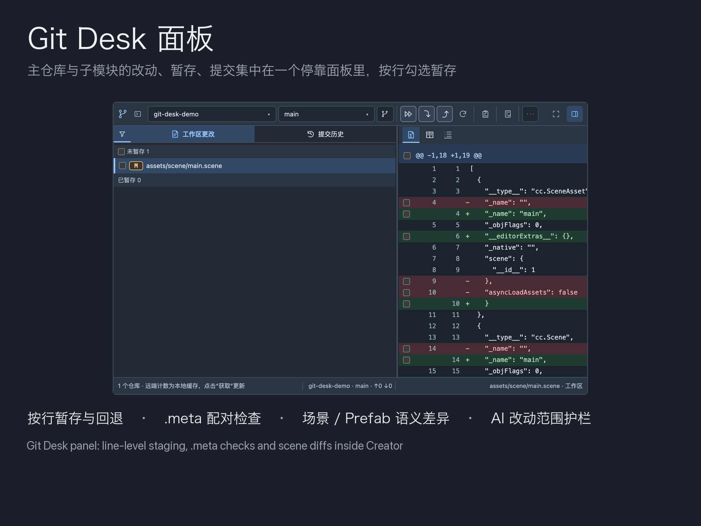
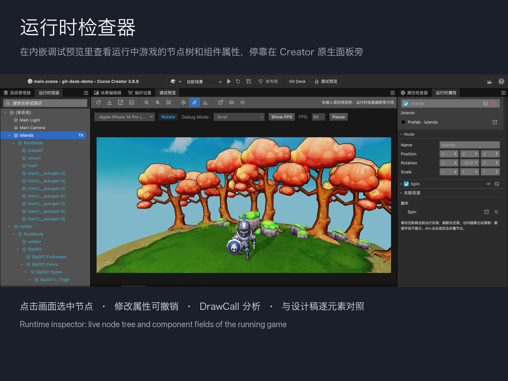

# Git Desk for Cocos Creator

[English](README.md)

Cocos Creator 3.8 扩展：在编辑器内管理项目主仓库和递归子模块的 Git，并把同一个 Git 服务、编辑器能力和运行中的预览通过带任务范围、令牌门禁的 MCP 开放给 AI 客户端。不执行任意代码：所有写操作都先生成计划、审阅后用一次性令牌执行。





## 与 funplay-cocos-mcp 的区别

| | funplay-cocos-mcp | cocos-git-desk |
| --- | --- | --- |
| 许可证 | MIT | MIT |
| 传输 | HTTP，固定 `127.0.0.1:8765` | stdio 适配器 → 本机回环随机端口，每次加载轮换令牌，连接文件 `0600` |
| 代码执行 | `execute_javascript` 在编辑器里执行任意代码 | 没有。固定工具集、只读消息白名单、检查器脚本方法白名单 |
| Git | — | 完整 Git 面板 + 15 个 `git_desk_*` 工具；写操作要求任务范围与一次性 token + digest |
| 工具数 | 约 90 | 77 个，分四组：核心 43、运行时检查器与事件采集 16、项目桥 17、多语言审计 1 |
| 编辑器界面 | — | Git Desk 面板、调试预览面板、运行时层级／运行时属性面板 |

两者不互斥；本扩展覆盖的是日常真正用到的编辑器操作，因此不再需要第二个编辑器 MCP。

## 功能

- **Git Desk 面板。** 主仓库与递归子模块；工作区／暂存区差异、逐行暂存、历史、Blame、引用日志、分支、标签、Stash、远端、合并与冲突处理、LFS 对象读取、隔离工作区、整项目快进更新。所有写操作先预览，预览两分钟过期。
- **Git MCP。** `git_desk_query` 做有界只读查询；写操作走 `task_start → prepare → execute`，任务基线落盘；提交检查覆盖整个索引并包含资源／`.meta` 一致性；已有或混合改动可发起人工审核；隔离 worktree 上下文。
- **编辑器工具。** 28 个 `creator_*` 工具，直接调用 Creator 的 asset-db、scene 与 preview 消息：资源查询／打开／定位／写入／删除、`.meta` 检查、`.prefab`／`.scene` 语义差异、受任务范围约束的场景与 Prefab 节点编辑、TypeScript 诊断、项目日志、截图、扩展重载。
- **运行时检查器。** 内嵌调试预览里运行中游戏的层级与属性，停靠在 Creator 原生面板旁；点击选中、带撤销的属性编辑、打印到控制台、UI 平铺布局导出并与设计稿坐标对照、DrawCall 捕获。见 [docs/RUNTIME_INSPECTOR.md](docs/RUNTIME_INSPECTOR.md)。
- **页面事件采集。** 通过 CDP 采集预览的控制台、异常、失败的 HTTP、WebSocket 元数据与导航，带脱敏；支持标记、等待重载、区间对比与现场导出。
- **项目桥（可选）。** 项目在预览里注入一个小的桥脚本后，再开放 17 个工具：列出／打开界面、切换语言、读 UI 树与状态、读请求时间线、注册仅预览生效的假响应。桥接口见 `docs/BRIDGE.md`（第二阶段）。

完整工具清单与参数由脚本生成到 [docs/TOOLS.md](docs/TOOLS.md)。

## 环境要求

- Cocos Creator 3.8.x（`editor: ">=3.8.0 <3.9.0"`），只在 3.8.8 实测。
- Git 2.26+ 在 `PATH`（或用 `COCOS_GIT_DESK_GIT` 指定）；「从提交新建分支」需要 Git 2.54+。
- Python 3.9+ 在 `PATH`，供 MCP 适配器和项目更新脚本使用（或用 `COCOS_GIT_DESK_PYTHON` 指定）。
- Git LFS 仅在项目使用 LFS 时需要；未安装时指针文件按指针显示，其他功能不受影响。
- 运行时不需要 Node.js 或 npm：发布包含已编译的 `dist/`，没有第三方依赖。

## 安装

**扩展管理器。** 从 Releases 下载 `cocos-git-desk-<version>.zip`，在 Creator 的「扩展 → 扩展管理器 → 项目」（或「全局」）里导入。

**手动解压。** 解压到 `<project>/extensions/cocos-git-desk/`，再到扩展管理器启用。先校验：

```sh
shasum -a 256 -c cocos-git-desk-<version>.zip.sha256
```

**源码安装。**

```sh
cd <project>/extensions
git clone https://github.com/jiaqihuu/cocos-git-desk.git
cd cocos-git-desk
npm ci --ignore-scripts
npm run build
```

然后在扩展管理器启用（已启用则重载）。用「Git Desk → 打开 Git Desk」或 `Cmd+Alt+G`／`Ctrl+Alt+G` 打开面板。

同一时间只启用一份：项目版和全局版同时存在时停用其中一个。

## 接入 AI 客户端

扩展加载时启动本机回环 RPC 服务，并写入 `extensions/cocos-git-desk/.cache/agent-connection.json`（权限 `0600`，每次加载轮换）。AI 客户端运行随包附带的 stdio 适配器，它读取该文件并把 MCP 的 `tools/call` 转发给编辑器。Creator 必须处于运行且打开该项目的状态，否则工具返回离线错误。

**Claude Code** — 把 [`templates/mcp.json`](templates/mcp.json) 复制为 `<project>/.mcp.json`。它通过 `CLAUDE_PROJECT_DIR` 定位适配器，可以随仓库提交共享：

```json
{
  "mcpServers": {
    "cocos-git-desk": {
      "type": "stdio",
      "command": "python3",
      "args": [
        "-c",
        "import os,runpy,sys; from pathlib import Path; root=Path(os.environ.get('CLAUDE_PROJECT_DIR') or os.getcwd()).resolve(); script=root/'extensions/cocos-git-desk/scripts/git-desk-mcp.py'; sys.argv=[str(script),'--project',str(root)]; runpy.run_path(str(script),run_name='__main__')"
      ]
    }
  }
}
```

**Codex** — 把 [`templates/codex-config.toml`](templates/codex-config.toml) 里的块加到 `<project>/.codex/config.toml`，`<project>` 换成绝对路径：

```toml
[mcp_servers.cocos-git-desk]
command = "python3"
args = ["<project>/extensions/cocos-git-desk/scripts/git-desk-mcp.py", "--project", "<project>"]
cwd = "<project>"
startup_timeout_sec = 30
tool_timeout_sec = 150
```

**其他 stdio MCP 客户端** — 启动命令：

```sh
python3 <project>/extensions/cocos-git-desk/scripts/git-desk-mcp.py --project <project>
```

适配器实现 `initialize`、`ping`、`tools/list`、`tools/call`，支持 MCP 协议版本 2025-11-25、2025-06-18、2025-03-26；不实现 HTTP 传输、resources、prompts 或取消。Windows 上把 `python3` 换成本机 Python 3 可执行文件路径。

连接后先调用 `git_desk_query` 的 `op: "capabilities"`；协议、任务流程与审核策略见 [docs/AGENT_API.md](docs/AGENT_API.md)。

## 配置

两个文件，都可缺省：

- `<project>/git-desk.config.json` — 随项目提交：预览地址与允许的引擎版本、桥对象名、指纹扫描根、多语言审计设置、允许面板写入哪些 AI 客户端配置。
- `<project>/extensions/cocos-git-desk/.cache/agent-settings.json` — 仅本机：`requireHumanReview` 与调试状态／导出目录。

全部键、默认值与含义见 [docs/CONFIG.md](docs/CONFIG.md)。

## 安全模型

- RPC 只绑定 `127.0.0.1` 随机端口；请求必须携带本次加载的令牌，带 `Origin` 或 `Sec-Fetch-Site` 头或 `Host` 不符的请求一律拒绝。
- 请求上限 128 KiB、响应 256 KiB；最多 8 个连接、4 个并发调用。
- 没有工具执行任意代码。`creator_message` 只接受固定的只读编辑器消息列表；检查器脚本随扩展打包，方法集固定。
- Git 写操作要求编辑前记录的任务范围、审阅过的计划、以及两分钟过期的一次性 token + digest。MCP 不能批准人工审核、不能 amend 提交，提交前始终检查整个索引。
- 这是协作门禁而不是沙箱：同一系统账户下任何能读到令牌文件的程序都能调用 RPC。

细节与报告渠道见 [SECURITY.md](SECURITY.md)。

## 限制与实测范围

- 测试套件在 CI 上覆盖 macOS、Linux 与 Windows。在编辑器里只在 macOS 的 Cocos Creator 3.8.8 上实际使用过；其他 3.8.x 版本以及 Windows、Linux 上的编辑器仍需实测。编辑器消息签名按 3.8.8 核对。
- Windows 不允许文件名含 `* ? : " < > |` 或控制字符，针对这类文件名的字面路径保护只在 macOS 与 Linux 上有意义。
- Windows 上令牌文件的保护依赖用户目录 ACL，请使用独立系统账户。
- 运行时检查器只注入内嵌调试预览，且只对 `preview.engineVersions` 列出的引擎版本生效。
- 单文件预览 5 MiB；差异渲染 15000 行；Git 命令输出 8 MiB；MCP 响应 256 KiB。用 `offset`／`limit`／`contains` 分页。
- 沿用本机 Git 凭据、hooks、过滤器与签名配置，不保存口令。
- Git 任务执行期间不要重载扩展或关闭 Creator。

## 开发

```sh
npm ci --ignore-scripts
npm run typecheck
npm run build
npm test          # 全套约 5 分钟，在 .test-work/ 下建临时仓库
npm run test:en   # 每个消息 id 都有英文
npm run package   # releases/cocos-git-desk-<version>.zip + .sha256
```

i18n 约定、提交信息与测试布局见 [CONTRIBUTING.md](CONTRIBUTING.md)；变更记录见 [CHANGELOG.md](CHANGELOG.md)。

## 许可证

[MIT](LICENSE)。
